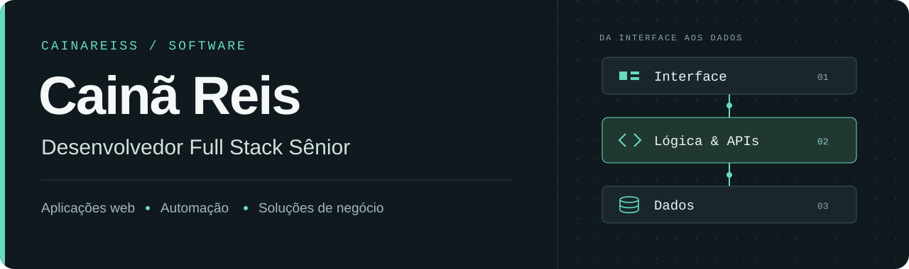
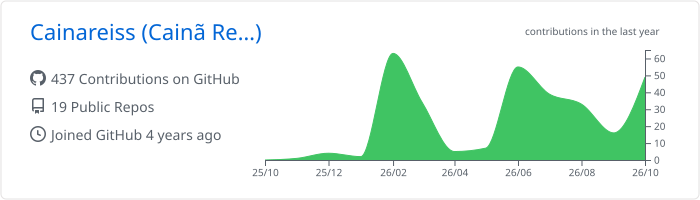

  

  <a href="#projetos-selecionados">Projetos</a> &nbsp;·&nbsp;
  <a href="#tecnologias">Tecnologias</a> &nbsp;·&nbsp;
  <a href="#contato">Contato</a>

Sou **Cainã Reis, desenvolvedor Full Stack Sênior**. Trabalho com aplicações web, automação e ferramentas para simplificar processos de negócio — da lógica do backend à experiência de quem usa a interface.

Aqui compartilho projetos próprios, adaptações de software aberto e estudos de engenharia. Meu foco é conectar código a problemas concretos: organizar informações, reduzir tarefas manuais e tornar operações mais simples.

## Projetos selecionados

| Projeto | O que você encontra | Tecnologias |
| :--- | :--- | :--- |
| **[Gerador de projetos CFTV](https://github.com/Cainareiss/Gerador_projetos_CFTV)** | Ferramenta desktop para montar projetos de CFTV e controle de acesso, selecionar equipamentos e gerar arquivos de projeto. | Python · Tkinter · JSON |
| **[FiadoDigital PDV](https://github.com/Cainareiss/PDV-FiadoDigital)** | Meu fork do sistema de ponto de venda de [Moisés Vila Nova](https://github.com/MoisesVNdev/PDV-FiadoDigital), voltado a vendas, estoque e controle de fiado no pequeno comércio. | Vue · TypeScript · Node.js · SQLite |
| **[Cadastro de usuários com Django](https://github.com/Cainareiss/Sistema-de-cadastro-django)** | Projeto de aplicação web com cadastro, listagem e exclusão de usuários, persistência em banco e interface com Bootstrap. | Python · Django · SQLite · Bootstrap |

[Ver todos os repositórios públicos →](https://github.com/Cainareiss?tab=repositories&type=public)

## Tecnologias

**Backend e automação** &nbsp; Python · Django · Node.js · scripts e ferramentas de linha de comando  
**Frontend** &nbsp; TypeScript · JavaScript · Vue · HTML · CSS  
**Dados e entrega** &nbsp; SQL · SQLite · Git · GitHub Actions

<strong>Laboratório de engenharia: portabilidade e consoles</strong>

Também exploro compatibilidade entre plataformas, integração com SDKs, empacotamento e diagnóstico de problemas de execução.

- **[EmulationStation UWP](https://github.com/Cainareiss/EmulationStation-UWP-edition):** port experimental do projeto de Aloshi para UWP/Xbox, com interface em C++ e navegação por controle.
- **[KH Days PS5](https://github.com/Cainareiss/KH-Days-PS5):** adaptação experimental do [khdays-port](https://github.com/Yokimitsuro/khdays-port), envolvendo vídeo, áudio e controles no PS5.

O estado de cada adaptação e os créditos dos projetos originais estão documentados nos respectivos repositórios.

<strong>Atividade no GitHub</strong>

<picture>
  <source media="(prefers-color-scheme: dark)" srcset="./profile-summary-card-output/github_dark/0-profile-details.svg" />
  <source media="(prefers-color-scheme: light)" srcset="./profile-summary-card-output/github/0-profile-details.svg" />
  
</picture>

## Contato

[LinkedIn](https://www.linkedin.com/in/cain%C3%A3-reis-9b1622152) &nbsp;·&nbsp;
[E-mail](mailto:darkreis2@gmail.com) &nbsp;·&nbsp;
[WhatsApp](https://api.whatsapp.com/send?phone=5585988768488) &nbsp;·&nbsp;
[Instagram](https://instagram.com/caina.darc)

Para conversar sobre desenvolvimento de software, automação ou colaborar em um projeto, entre em contato.
